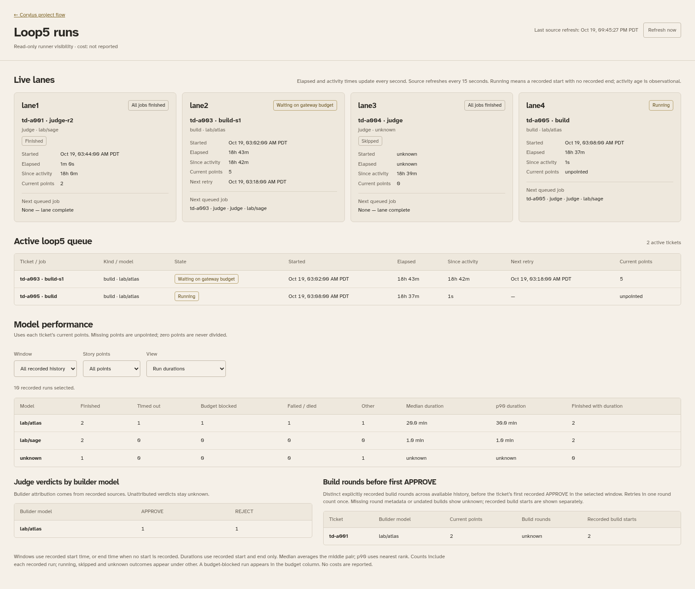

# Loop5 runs in the td viewer

Written by an AI agent: Codex (GPT-6.1 Sol).

Open **Loop5 runs** in the project-flow header. The page refreshes source observations
every 15 seconds and updates elapsed/activity clocks every second. It shows serial
lanes, their current or latest recorded run and next job, active schema-2 queue
tickets, model outcomes, durations, judge verdicts and story-point comparisons.
Costs are displayed as **not reported**.

Enable the source with the existing viewer command plus:

```sh
python3 td_flow.py --project Corylus=/path/to/corylus --loop5-state-dir /path/to/loop5
```

The option is server configuration. The browser cannot select a directory. An
unconfigured, missing or unreadable source produces a clear page message while
the dependency viewer remains available. This change includes no deployment,
service restart, ingress change, runner control or writes to loop5 sources.

## What the numbers mean

- A recorded start is a run. Repeated labels remain separate runs. A terminal
  event without its start remains visible with an unknown start and duration.
- Outcomes come from recorded events and terminal provider diagnostics. A past
  budget-blocked attempt remains in the budget count after a later retry starts.
  Skipped, running and unknown outcomes are counted under **other**.
- Finite windows use the recorded start, or the recorded end for a run with no
  start. Undated records appear only in all history. Future records are excluded.
- Finished duration summaries require a recorded start and end. Median averages
  the middle pair. P90 uses nearest rank. Missing durations are excluded, with the
  sample count shown.
- A judge's builder model is only populated from a recorded queue-round or lane
  build/judge association. Missing model or association evidence remains unknown.
- Build rounds count distinct explicit recorded round numbers before the first
  recorded APPROVE. Missing round metadata produces **unknown**, rather than
  treating gateway retries or label numbers as rounds. Recorded build starts are
  shown separately. Round summaries group approved tickets by builder and points.
- Points use current td records from configured projects, then schema-2 state
  where td has no value. Missing values are **unpointed**. Zero stays separate and
  is never a divisor. This is current-point analysis, not points at run time.
- Normalized duration is the median of each finished build's minutes divided by
  its positive points. Outcome rates use all selected recorded runs for each
  model and point value, including other outcomes in their denominators.

**Running** means a start with no recorded end; activity age helps identify quiet
runs. This page does not probe process liveness. A scheduled retry is shown only
where its delay is recorded. Expired retry times remain visible as observations,
not promises that a worker will restart. Older unsupported formats remain
unknown; missing events are never reconstructed.
Unsupported start/terminal event formats produce a warning and are excluded
rather than reconstructed as runs. The totals describe recognized td-ticket
run records, not an inventory of every artifact in the state directory.

## Read-only and privacy boundary

`/api/runs` accepts no query parameters and inherits the viewer's Host, Origin,
read-only-method and response-security guards. The static-file allowlist names
only the page's four assets. No source file is served.

The parser opens regular source files read-only and rejects symlinks. It reads
bounded status, state, lane, metadata, diagnostic and final-result files, returning
only structured observations. Prompts, outputs, transcripts, raw event messages,
credentials and full private paths never appear in the API. Public identifiers
reject credential-like and token-shaped values. Source failures use fixed,
path-free messages. Source-size limits produce incomplete-data warnings.

Reads are coalesced in a five-second cache. Points reads use bounded `td list`
commands against the project allowlist; they do not invoke `td export`.

## Verification

```sh
make test PYTHON=/path/to/venv/bin/python
make lint PYTHON=/path/to/venv/bin/python
make browser-test PYTHON=/path/to/venv/bin/python
```

The runs browser check creates synthetic source files, checks exact hand-counted
values, privacy, filters, polling, failure recovery and mobile overflow. It never
reads production sources or calls models. Its screenshots are synthetic:


